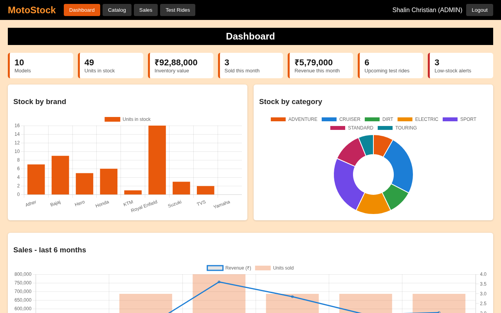
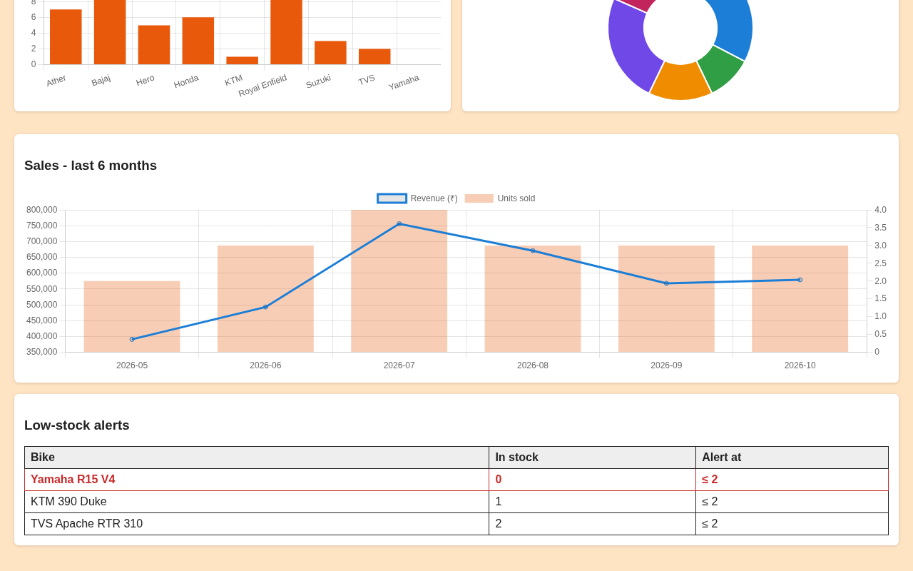
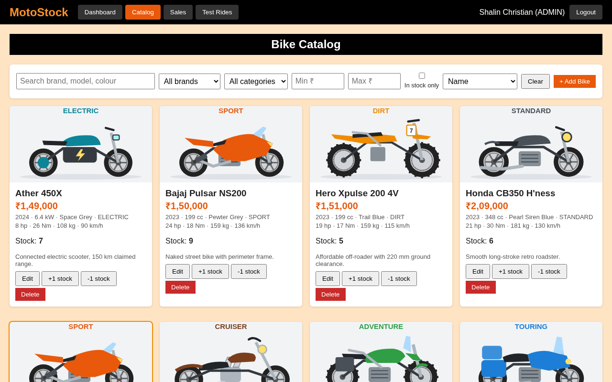
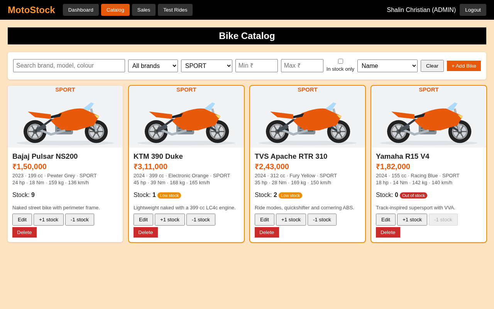
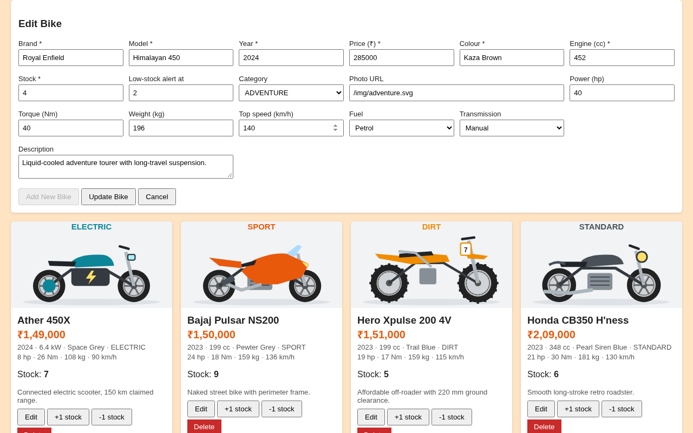
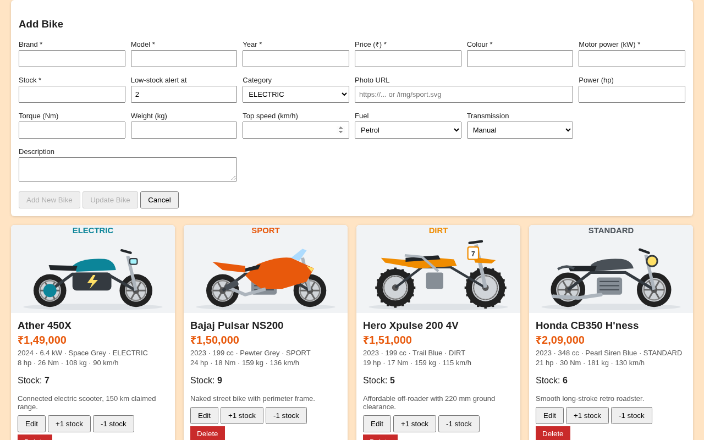
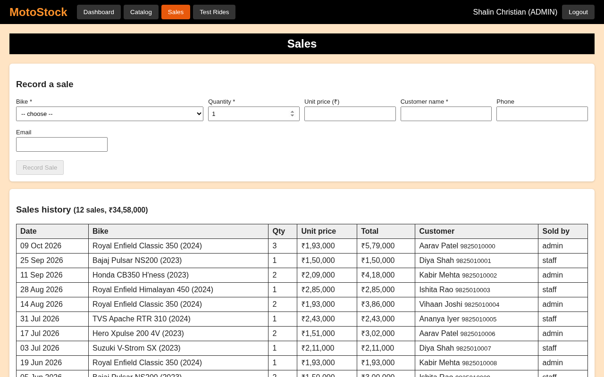
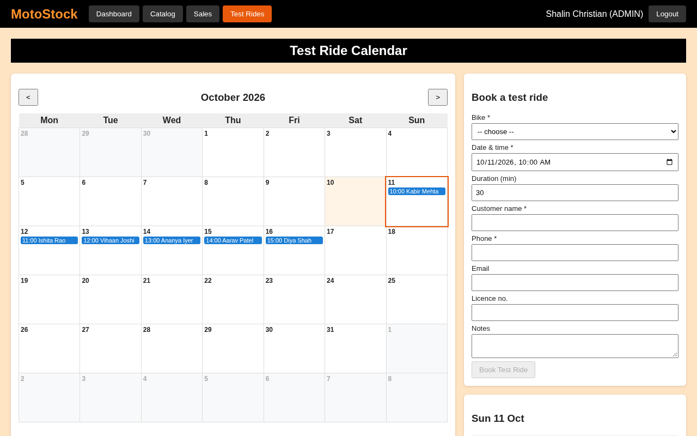
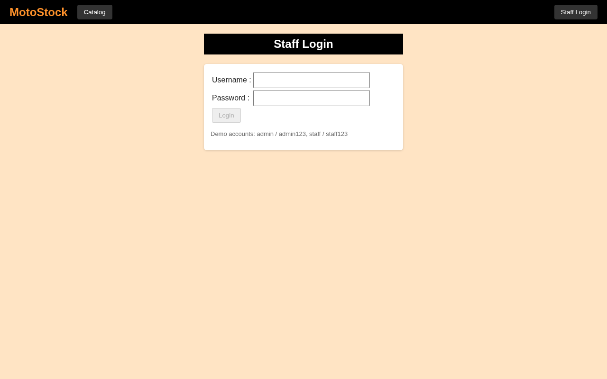
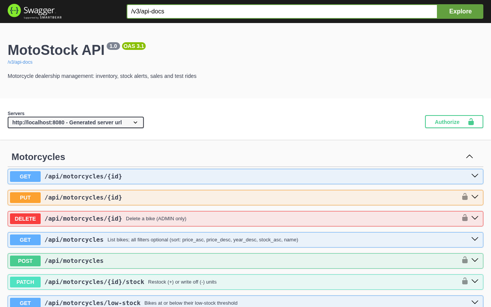

# MotoStock


MotoStock is a management app for a motorcycle dealership. It tracks inventory and stock alerts, records sales, and books test rides, all from one dashboard.



---

## Features

- **Bike catalog** with photos, specs, and search by brand, category, price, and stock. Electric bikes show motor power in kW.
- **Stock tracking** with a low-stock alert threshold for each bike
- **Sales** that reduce stock automatically and refuse to oversell
- **Test-ride bookings** on a monthly calendar that blocks clashing time slots
- **Dashboard** with stock and sales charts
- **JWT login** with two roles. Staff manage stock, sales, and bookings, and only admins can delete bikes.
- **Swagger docs** for every endpoint

---

## Screenshots

| | |
|---|---|
| <br>*Recent sales and low-stock alerts* | <br>*Bike catalog* |
| <br>*Filtered catalog* | <br>*Edit a bike* |
| <br>*Electric bike form with kW* | <br>*Sales* |
| <br>*Test-ride calendar* | <br>*Staff login* |
| <br>*Swagger API docs* |  |

---

## Tech Stack

| Layer | Technologies |
|---|---|
| Backend | Java 17, Spring Boot 3.5, Spring Data JPA, Spring Security with JWT, Bean Validation, springdoc OpenAPI |
| Database | H2 for development, MySQL for production |
| Frontend | AngularJS 1.8, Chart.js, Express (static files and API proxy) |
| Tests | JUnit 5, Mockito, MockMvc |
| Deployment | Docker Compose (MySQL, API, and web) |

---

## Getting Started

**With Docker**

```bash
cp .env.example .env
docker compose up --build
```

- Web app: http://localhost:4000
- API: http://localhost:8080 (Swagger at `/swagger-ui.html`)

**Without Docker**

```bash
cd backend && ./mvnw spring-boot:run      # H2 in memory, seeded with demo data
cd web && npm install && npm start        # in a second terminal, http://localhost:4000
```

**Demo logins:** `admin` / `admin123` and `staff` / `staff123`. Change them with `ADMIN_PASSWORD` and `STAFF_PASSWORD`.

**Tests:** run `cd backend && ./mvnw test`.

---

## API

| Method | Path | Access |
|---|---|---|
| GET | `/api/motorcycles` (filters: `q`, `brand`, `category`, `minPrice`, `maxPrice`, `inStock`, `sort`) | public |
| GET | `/api/motorcycles/{id}`, `/low-stock`, `/brands` | public |
| POST, PUT | `/api/motorcycles`, `/api/motorcycles/{id}` | staff, admin |
| PATCH | `/api/motorcycles/{id}/stock` | staff, admin |
| DELETE | `/api/motorcycles/{id}` | admin |
| GET, POST | `/api/sales` | staff, admin |
| GET, POST, PATCH, DELETE | `/api/test-rides` | staff, admin |
| GET | `/api/dashboard` | staff, admin |
| POST, GET | `/api/auth/login`, `/api/auth/me` | public, token |

---

## Project Structure

```
backend/   Spring Boot API: controller, dto, mapper, service (interfaces + impl), entity,
           repository, security, config, exception
web/       AngularJS app (MotoApp/) served by an Express server that proxies /api
docker-compose.yml
```

See `DEALERSHIP.md` for detailed notes.

## Connect With Me

**Shalin Christian**, [GitHub](https://github.com/shalinchristian)
